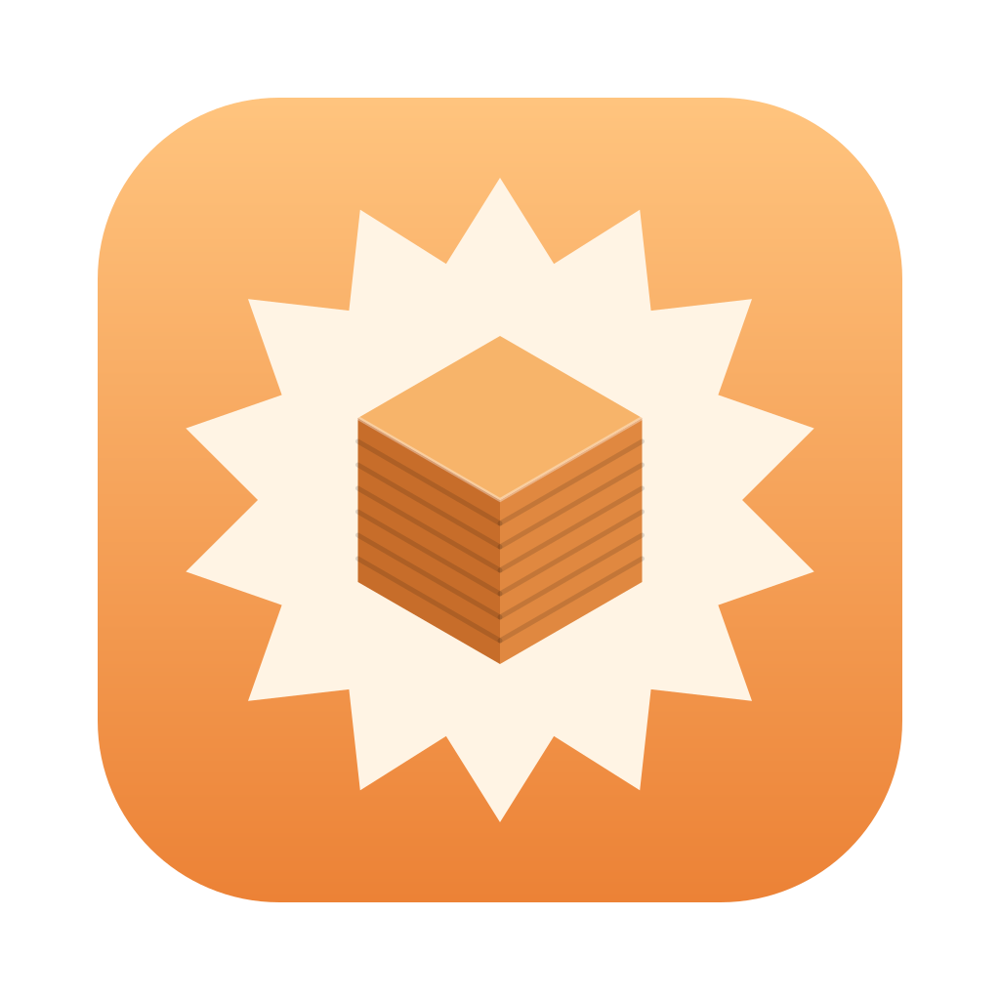
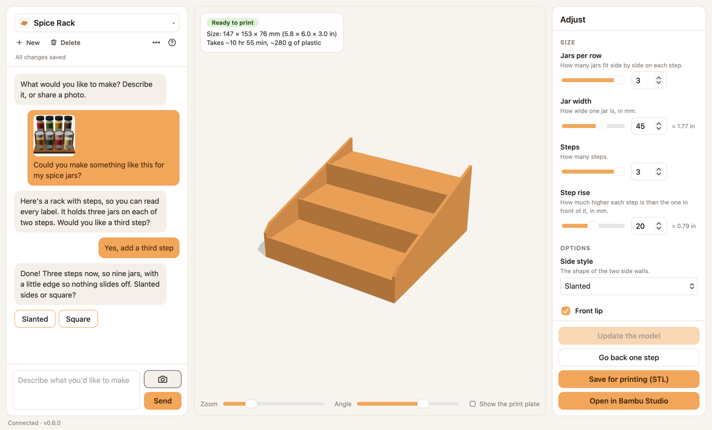
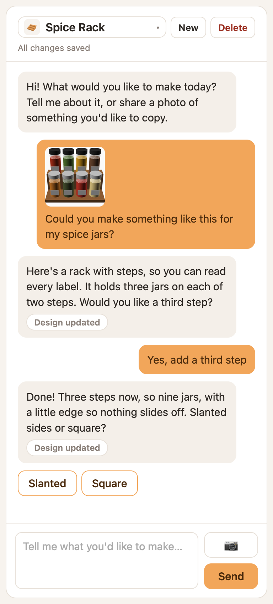
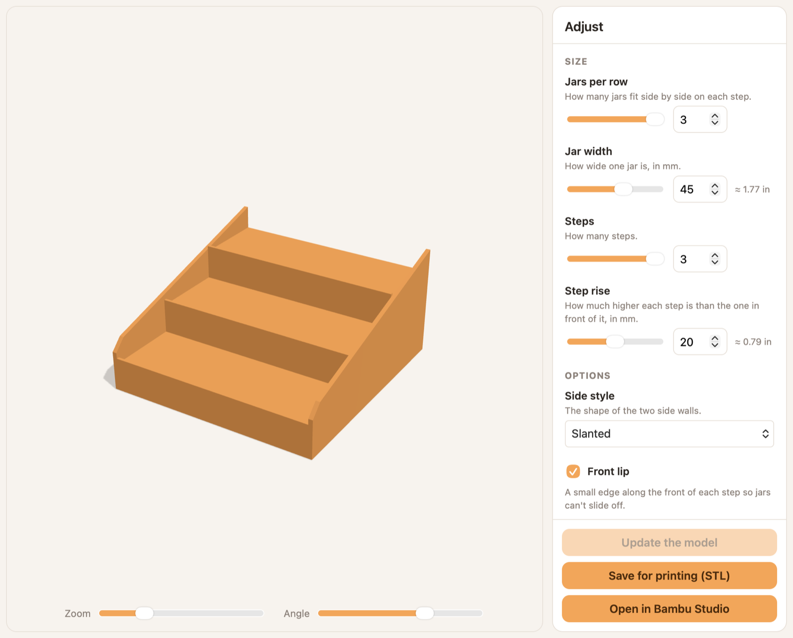
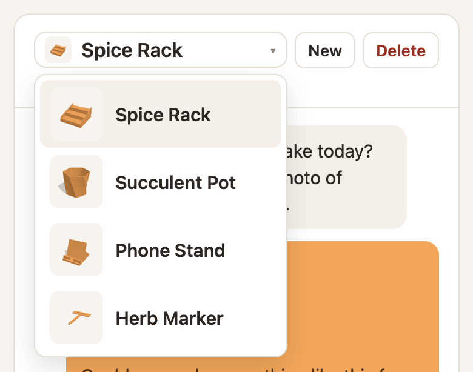

<p align="center">
  
</p>

<h1 align="center">Print Explosion 3D</h1>

<p align="center">
  <strong>Describe it, see it spin, print it.</strong><br>
  A single-window Mac app that turns a chat (and photos) into a 3D-printable model for a Bambu Lab A1 mini.
  No CAD knowledge, no accounts, no jargon.
</p>

<!-- SCREENSHOT: hero. Full window mid-design: chat on the left, spinning model in the middle, Adjust panel on the right. -->


## Why this exists
Back in the day, my mom would run Print Explosion Deluxe on her iMac G3 and print custom Avery labels
for pretty much everything. It was her jam, and she really misses it. Avery labels and ink are also
really expensive.

My parents have always been curious about 3D printing, but it would be way too hard to teach them to,
say, unclog a hotend. So I bought them a Bambu Lab A1 mini that they can happily use and maintain.
Mom loves it, but there is a gap between "I have a printer" and "I can make the thing I'm imagining."
There are lots of AI-to-STL tools, but they all want a login or some technical know-how. This is the
easy-to-install, easy-to-update, easy-to-use version, where she can make fun stuff and get creative.

## How it works
1. **Tell it what you want.** Type it, or drop in a photo ("something like this, but for my
   spice jars"). Any units and everyday words are fine.
2. **Watch it appear.** The model shows up in the middle and slowly spins. Click it to pause, and use
   the sliders to look from a different angle.
3. **Tweak it.** Sizes and options show up on the right as simple boxes, sliders and dropdowns. Change
   one, press **Update the model**, and see it again.
4. **Print it.** **Save for printing** gives you an STL file, or **Open in Bambu Studio** sends it
   straight to the slicer.

<!-- SCREENSHOT: chat. A short conversation with a photo attached, a "Design updated" chip, and quick-reply buttons. -->


<!-- SCREENSHOT: adjust. The Adjust panel with sliders, a dropdown and a checkbox, next to the spinning model. -->


<!-- SCREENSHOT: projects. The project switcher listing a few saved projects, plus the autosave status. -->


<!-- SCREENSHOT: bambu. The finished model open in Bambu Studio. -->


## What it's built for
- **Easy prints.** Designs fit the A1 mini's 180 mm bed, sit flat, avoid supports, and have a small
  chamfer on the bottom edge so they print without a brim and pop off the plate.
- **Always tweakable.** Every design exposes its key measurements as simple controls, so small
  changes never need another chat round.
- **Friendly errors.** If something goes wrong, the app quietly asks the designer to fix it. She never
  sees code or error messages.
- **No file browser.** Projects save automatically. Say "open my bird feeder" in the chat to resume,
  or use New / Delete at the top.
- **Works offline** for everything except the chat itself.
- **Stays up to date by itself.** The app updates from this repo, with a short plain-English note
  about what changed (see `CHANGELOG.md`).

## Under the hood
- The chat uses the Anthropic API (Claude), behind a small provider interface so another AI can be
  plugged in. Cheap local logic (regex, fuzzy matching) handles anything that doesn't need a model, to
  save credits.
- The designer writes parametric [OpenSCAD](https://openscad.org) files, rendered locally to STL.
- UI is a pywebview window with a vanilla-JS Three.js viewer. No build step.
- Projects live in `~/Documents/Print Explosion 3D/`.

Architecture and conventions are in [`CLAUDE.md`](CLAUDE.md). Progress is in
[`docs/ROADMAP.md`](docs/ROADMAP.md).

## Running it
Requires macOS, [uv](https://docs.astral.sh/uv/), OpenSCAD 2025 or newer, and an Anthropic API key
in `.env` as `ANTHROPIC_API_KEY`.

```sh
uv sync
uv run print-explosion
```

Print a commented template of every setting (colors, timeouts, model, and so on) with:

```sh
uv run python -m print_explosion_3d.config
```

### One-step install (fresh Mac)
```sh
bash <(curl -fsSL https://raw.githubusercontent.com/bradmartin333/print-explosion-3d/main/scripts/install.sh)
```
It checks for git, uv and OpenSCAD 2025+, downloads the app to `~/PrintExplosion3D`, asks for the
AI key, and creates `~/Applications/Print Explosion 3D.app` (drag it to the Dock). That app only runs
`scripts/launch.sh`, which pulls the latest `main` and starts the app, so updates arrive by themselves.
Launch logs are in `~/Library/Logs/PrintExplosion3D`. The app also checks for updates on start and
shows an "Update now" banner when `main` is ahead (it stays quiet on a development checkout).
